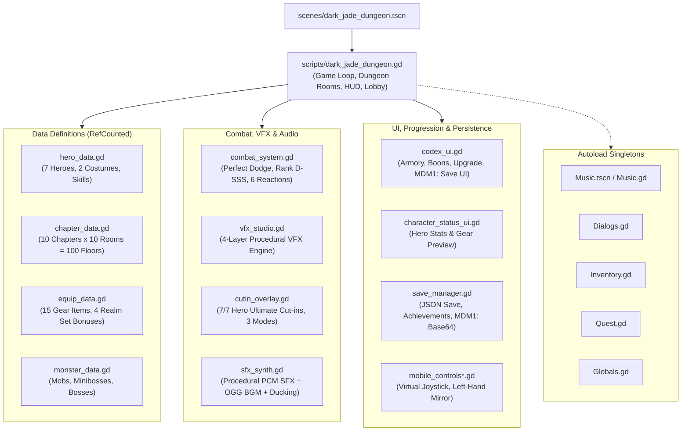

# Technical Handoff & Architecture Report: มหาแดนพันภพ (maha-dan-morta & maha-dan-morta-mobile)

> **วันที่จัดทำ:** 2026-11-24  
> **Engine:** Godot Engine `v4.7.2.stable.official.ed1daf0bf` (Config features: `4.3`, `Forward Plus`, Web Renderer: `gl_compatibility` / WebGL2)  
> **ขอบเขตเอกสาร:** โครงการ Godot 4 ทั้ง 2 โปรเจกต์ใน `/Users/jake/Downloads/rocg/` ได้แก่ `maha-dan-morta` (Desktop / iPad Landscape) และ `maha-dan-morta-mobile` (Mobile Portrait Spin-off: มหาแดน gogo M)

---

## 1. ภาพรวมโปรเจกต์ (Project Overview)

ทั้งสองโปรเจกต์พัฒนาด้วย **Godot 4 (GDScript)** โดยใช้สถาปัตยกรรมแบบ **Procedural Scene & UI** เกือบทั้งหมดผ่านสคริปต์หลัก [`dark_jade_dungeon.gd`](file:///Users/jake/Downloads/rocg/maha-dan-morta/scripts/dark_jade_dungeon.gd) (ไฟล์ `.tscn` หลักมีเพียง Root Node เดียว) รองรับการ Export เป็น **WebGL2 + Progressive Web App (PWA)** เพื่อเล่นผ่าน Browser, iPad และ iPhone ผ่าน HTTPS Tunnel หรือ LAN

### สถานะ Git ล่าสุด (ณ 2026-11-24)
- **`maha-dan-morta`** (`main` @ `1013476`): `fix(p2): fix _rebuild_party_hud call and mobile codex sheet height`
- **`maha-dan-morta-mobile`** (`main` @ `1961e2f`): `fix(p2): fix _rebuild_party_hud call and mobile codex sheet height`

---

## 2. ตารางเปรียบเทียบ `maha-dan-morta` vs `maha-dan-morta-mobile`

| หัวข้อเปรียบเทียบ | `maha-dan-morta` | `maha-dan-morta-mobile` |
| :--- | :--- | :--- |
| **ชื่อแอป (`config/name`)** | มหาแดนพันภพ: ศึกผนึกกระบี่สะบั้นสวรรค์ | มหาแดน gogo M |
| **Viewport (`project.godot`)** | `1280 x 720` (Landscape, `canvas_items`, `expand`) | `540 x 880` (Portrait, `canvas_items`, `expand`) |
| **Handheld Orientation** | `0` (Landscape) / PWA `orientation: 1` (`landscape`) | `1` (Portrait) / PWA `orientation: 2` (`portrait`) |
| **Main Scene** | [`scenes/dark_jade_dungeon.tscn`](file:///Users/jake/Downloads/rocg/maha-dan-morta/scenes/dark_jade_dungeon.tscn) | [`scenes/dark_jade_dungeon.tscn`](file:///Users/jake/Downloads/rocg/maha-dan-morta-mobile/scenes/dark_jade_dungeon.tscn) |
| **Mobile Touch Controls** | [`mobile_controls_landscape.gd`](file:///Users/jake/Downloads/rocg/maha-dan-morta/scripts/mobile_controls_landscape.gd) (323 บรรทัด) | [`mobile_controls.gd`](file:///Users/jake/Downloads/rocg/maha-dan-morta-mobile/scripts/mobile_controls.gd) (320 บรรทัด, มี `help_pressed` + `hero_slot_col`) |
| **ไฟล์หลัก `dark_jade_dungeon.gd`** | 4,647 บรรทัด | 3,919 บรรทัด (ปรับ Layout & Responsive สำหรับจอมือถือแนวตั้ง) |
| **HD-2D Prototype** | มี ([`test_hd2d_prototype.tscn`](file:///Users/jake/Downloads/rocg/maha-dan-morta/scenes/test_hd2d_prototype.tscn), [`test_hd2d_prototype.gd`](file:///Users/jake/Downloads/rocg/maha-dan-morta/scripts/test_hd2d_prototype.gd) 1,050 บรรทัด) | ไม่มี (ตัดออกเพื่อโฟกัส Mobile Build) |
| **ปริมาณโค้ด GDScript (Singletons + Scripts)** | 11,390 บรรทัด | ~9,655 บรรทัด (เฉพาะ `scripts/` 9,387 บรรทัด + `singletons/` 268 บรรทัด) |
| **ขนาด Build Web (`build/web/`)** | ~99 MB (`build/hd2d_web/` ~91 MB) | ~84 MB |
| **LAN / Tunnel Dev Port** | `8089` ([`play_ipad_wifi.sh`](file:///Users/jake/Downloads/rocg/maha-dan-morta/tools/play_ipad_wifi.sh)) | `8088` ([`play_iphone_wifi.sh`](file:///Users/jake/Downloads/rocg/maha-dan-morta-mobile/tools/play_iphone_wifi.sh)) |
| **ผลทดสอบ QA (`run_qa.sh`)** | **7/9 PASS, 2 FAIL** | **9/9 PASS (100%)** |
| **ผลทดสอบ Extra E2E** | `test_p3_polish_e2e.gd` PASS, `test_hd2d_prototype_e2e.gd` PASS | `test_p3_polish_e2e.gd` PASS |

### ไฟล์ที่แชร์โค้ดเหมือนกัน 100% vs ต่างกันระหว่าง 2 โปรเจกต์
- **เหมือนกันทุกบรรทัด:** `singletons/*`, `combat_system.gd`, `cutin_overlay.gd` (logic หลักต่างเล็กน้อยตาม diff check), `equip_data.gd`, `hero_data.gd`, `monster_data.gd`, `save_manager.gd`, `sfx_synth.gd`, `vfx_studio.gd`
- **ปรับแต่งเฉพาะโปรเจกต์ (`diff` ต่างกัน):**
  - [`dark_jade_dungeon.gd`](file:///Users/jake/Downloads/rocg/maha-dan-morta/scripts/dark_jade_dungeon.gd) vs [`mobile`](file:///Users/jake/Downloads/rocg/maha-dan-morta-mobile/scripts/dark_jade_dungeon.gd)
  - [`codex_ui.gd`](file:///Users/jake/Downloads/rocg/maha-dan-morta/scripts/codex_ui.gd) (607 บรรทัด) vs [`mobile`](file:///Users/jake/Downloads/rocg/maha-dan-morta-mobile/scripts/codex_ui.gd) (657 บรรทัด)
  - [`character_status_ui.gd`](file:///Users/jake/Downloads/rocg/maha-dan-morta/scripts/character_status_ui.gd) (431 บรรทัด) vs [`mobile`](file:///Users/jake/Downloads/rocg/maha-dan-morta-mobile/scripts/character_status_ui.gd) (427 บรรทัด)
  - [`chapter_data.gd`](file:///Users/jake/Downloads/rocg/maha-dan-morta/scripts/chapter_data.gd) vs [`mobile`](file:///Users/jake/Downloads/rocg/maha-dan-morta-mobile/scripts/chapter_data.gd)
  - [`mobile_controls_landscape.gd`](file:///Users/jake/Downloads/rocg/maha-dan-morta/scripts/mobile_controls_landscape.gd) vs [`mobile_controls.gd`](file:///Users/jake/Downloads/rocg/maha-dan-morta-mobile/scripts/mobile_controls.gd)

---

## 3. สถาปัตยกรรมระบบ (System Architecture)



### 3.1 Autoload Singletons (`singletons/`)
ลงทะเบียนใน `project.godot` ทั้งสองโปรเจกต์เหมือนกัน:
1. `Music` ([`Music.tscn`](file:///Users/jake/Downloads/rocg/maha-dan-morta/singletons/Music.tscn) / [`Music.gd`](file:///Users/jake/Downloads/rocg/maha-dan-morta/singletons/Music.gd), 34 บรรทัด) — Crossfade เพลง A/B และใส่ Low-pass filter อัตโนมัติเมื่อ `NOTIFICATION_PAUSED`
2. `Dialogs` ([`Dialogs.gd`](file:///Users/jake/Downloads/rocg/maha-dan-morta/singletons/Dialogs.gd), 54 บรรทัด) — ระบบบทสนทนาพื้นฐาน
3. `Inventory` ([`Inventory.gd`](file:///Users/jake/Downloads/rocg/maha-dan-morta/singletons/Inventory.gd), 45 บรรทัด) — คลังไอเทม Dictionary + Signal `item_changed`
4. `Quest` ([`Quest.gd`](file:///Users/jake/Downloads/rocg/maha-dan-morta/singletons/Quest.gd), 72 บรรทัด) — สถานะเควส (`NONEXISTENT`, `STARTED`, `COMPLETE`, `FAILED`)
5. `Globals` ([`Globals.gd`](file:///Users/jake/Downloads/rocg/maha-dan-morta/singletons/Globals.gd), 63 บรรทัด) — จัดการ `user://savegame.save` พื้นฐานของเทมเพลต

> **หมายเหตุสำหรับผู้พัฒนา:** ระบบเซฟจริงของเกมหลักถูกจัดการผ่าน `SaveManager` (`scripts/save_manager.gd` -> `user://save_data.json`) ไม่ได้พึ่ง `Globals.save_game()` โดยตรง

### 3.2 Data Layer (`RefCounted` Static Dictionaries)
- **[`hero_data.gd`](file:///Users/jake/Downloads/rocg/maha-dan-morta/scripts/hero_data.gd) (161 บรรทัด):**
  - `HERO_ORDER`: 7 ตัวละคร (`bai_yueling`, `ye_shangye`, `song_ren`, `chen_xi`, `yu_han`, `zhao_yan`, `hei_shan`)
  - `DEFAULT_PARTY`: `["bai_yueling", "ye_shangye", "song_ren"]`
  - สกิลครบ 3 ปุ่ม (`q_name`, `e_name`, `r_name`), 2 ชุด (Default + Alt Costume), ค่าสถานะ (`max_hp`, `max_sp`, `speed`, `atk`, `crit`, `range`, `is_ranged`) และ Path ของ VFX
- **[`chapter_data.gd`](file:///Users/jake/Downloads/rocg/maha-dan-morta/scripts/chapter_data.gd) (266 บรรทัด):**
  - `TOTAL_CHAPTERS := 10`, `ROOMS_PER_CHAPTER := 10`, `ROOM_STRIDE := 16` (`16 tiles * 64px * 10 rooms = 10,240 px/chapter` รวม **100 Floors**)
  - กำหนด `mob_a`, `mob_b`, `miniboss`, `boss`, `boss_hp`, `ult_name`, `hazard` (`fire_pillar`, `poison_mist`, `blood_swords` ฯลฯ) และโทนสีแสง/พื้น/กำแพง
- **[`equip_data.gd`](file:///Users/jake/Downloads/rocg/maha-dan-morta/scripts/equip_data.gd) (368 บรรทัด):**
  - อุปกรณ์ 15 ชิ้น (`ITEM_ORDER`) แบ่ง 3 ช่อง (`weapon`, `armor`, `relic`) พร้อมระบบอัปเกรด `+1..+5`
  - **4 Realm Set Bonuses** (`REALM_SET_BONUSES`): มนุษย์, เซียน, มาร, เทพ
- **[`monster_data.gd`](file:///Users/jake/Downloads/rocg/maha-dan-morta/scripts/monster_data.gd) (106 บรรทัด):**
  - นิยามมอนสเตอร์พื้นฐาน (`cultist`, `hound`, `golem`, `puppet` ฯลฯ)

### 3.3 Combat, VFX & Audio Systems
- **[`combat_system.gd`](file:///Users/jake/Downloads/rocg/maha-dan-morta/scripts/combat_system.gd) (243 บรรทัด):**
  - **Perfect Dodge:** หน้าต่าง `0.22s`, Slow-motion `0.35x` นาน `0.90s`, คืน SP `+30`, คริติคอลคูณ `1.80x`
  - **Combo Rank (`D` -> `SSS`):** 7 ระดับ เพิ่ม Damage Bonus สูงสุด `+35%` และ Jade Bonus `+50%` ที่ Rank `SSS` (`min_score: 320`)
  - **Elemental System:** 4 ธาตุ (`ice`, `lightning`, `pyro`, `nature`) และ **6 Elemental Reactions** (`melt`, `overload`, `superconduct`, `burning` ฯลฯ)
- **[`vfx_studio.gd`](file:///Users/jake/Downloads/rocg/maha-dan-morta/scripts/vfx_studio.gd) (1,769 บรรทัด):**
  - Procedural VFX Engine 4-Layer (Azure Star Rings, Critical Star Burst, Frostbound/Spikes, Galaxy Vortex/Smoldering Burn, Summoning Circle Pillar & Sky Volley) ใช้ `CanvasItemMaterial.BLEND_MODE_ADD`
- **[`cutin_overlay.gd`](file:///Users/jake/Downloads/rocg/maha-dan-morta/scripts/cutin_overlay.gd) (546 บรรทัด):**
  - รองรับ Ultimate Cut-in ครบทั้ง **7/7 ฮีโร่** ใช้ Sprite Sheet (`.jpg` 6x5 = 30 เฟรม) + เสียง `.wav`
  - มี 3 โหมด (`full`, `card`, `off`) โดยโหมด `full` จะหยุดเวลาการต่อสู้ชั่วคราว (held damage) และปล่อยดาเมจเมื่อ `fullscreen_finished` (จบคลิปหรือ Tap Skip หลัง `FULL_SKIP_GUARD := 0.25s`)
- **[`sfx_synth.gd`](file:///Users/jake/Downloads/rocg/maha-dan-morta/scripts/sfx_synth.gd) (260 บรรทัด):**
  - สังเคราะห์เสียง SFX แบบ Procedural PCM (`MIX_RATE := 22050`) จำนวน 18 เสียง (`slash`, `talisman`, `hit`, `crit`, `perfect_dodge`, `reaction`, `ultimate` ฯลฯ) พร้อม Audio Pool 10 ช่อง
  - โหลด OGG BGM (`310-world-map-loop.ogg` และ `a-2-3-groovy-bgm.ogg` สำหรับบอส) พร้อมระบบ Ducking และ Fallback Loop

### 3.4 UI, Progression & Cross-Device Save
- **[`save_manager.gd`](file:///Users/jake/Downloads/rocg/maha-dan-morta/scripts/save_manager.gd) (345 บรรทัด):**
  - จัดการเซฟที่ `user://save_data.json` เก็บ `spirit_jade`, `difficulty`, `core_upgrades` (`hp_lv`, `sp_lv`, `atk_lv`, `orb_lv`), `hero_passives`, `party`, `costumes`, `cleared_chapters`, `cutin_mode`, `bgm_enabled`, `owned_gear`, `hero_gear`, `gear_levels`, `chapter_records`, `achievements`, `tutorial_completed`, `touch_mirror`, `game_speed`
  - **Cross-Device Save Code (`MDM1:`):** เข้ารหัส/ถอดรหัส Base64 สำหรับย้ายเซฟข้ามเครื่องผ่าน [`codex_ui.gd`](file:///Users/jake/Downloads/rocg/maha-dan-morta/scripts/codex_ui.gd)

---

## 4. โครงสร้าง Assets & Build Artifacts

| โฟลเดอร์ | `maha-dan-morta` | `maha-dan-morta-mobile` | รายละเอียด |
| :--- | :--- | :--- | :--- |
| `assets/heroes/` | 38 MB | 28 MB | Sprite Sheets 7 ฮีโร่ (4-direction + alt costumes) |
| `assets/vfx/` | 6.3 MB | 6.3 MB | VFX textures + 7 Hero Cut-in sheets (`.jpg`) & audio (`.wav`) |
| `assets/monsters/` | 1.7 MB | 1.7 MB | Mobs, Minibosses (`mb_ch*`), Bosses (`boss_ch*`) |
| `assets/env/` | 656 KB | 120 KB | พื้น/กำแพง/ต้นไผ่/แท่นบูชา |
| `assets/hd2d/` | 7.6 MB | - | Assets เฉพาะ HD-2D Prototype |
| `music/` | 2.8 MB | มี (OGG BGM) | เพลง BGM หลักและเพลงบอส |
| `fonts/` | 3.3 MB | มี (ชุดเดียวกัน) | `Sarabun-Medium.ttf` (ภาษาไทย), `NotoEmoji.ttf`, `NotoSansSymbols2.ttf`, `Candy Demo` |
| `build/web/` | 99 MB | 84 MB | ผลลัพธ์ WebGL2 + PWA (`index.html`, `.pck`, `.wasm`, `index.manifest.json`, `.nojekyll`, `_headers`) |

> **ข้อสังเกต:** ใน [`export_presets.cfg`](file:///Users/jake/Downloads/rocg/maha-dan-morta/export_presets.cfg) บรรทัด `exclude_filter` มีการคัดกรอง `tests/*,tools/*,editables/*,docs/*,music/*,sounds/*,...` ออกจาก `.pck` เพื่อให้ขนาด Web Build กระชับ

---

## 5. Build, Export & Deployment Pipeline (`tools/`)

### คำสั่งสำคัญสำหรับนักพัฒนา
1. **รัน QA Suite (Headless):**
   ```bash
   cd maha-dan-morta && ./tools/run_qa.sh
   cd maha-dan-morta-mobile && ./tools/run_qa.sh
   ```
2. **Export WebGL2 + PWA Build:**
   ```bash
   ./tools/export_web.sh
   ```
   - ใช้ Godot CLI `--export-release "Web" build/web/index.html` (หากไม่มี Export Template `4.7.2.stable` จะเรียก `tools/fetch_web_template.py` อัตโนมัติ)
   - Patch `build/web/index.manifest.json` (`display: standalone`, `orientation: landscape` หรือ `portrait`) และสร้าง `.nojekyll` + `_headers`
3. **ทดสอบบน iPad / iPhone ผ่าน Wi-Fi (HTTPS Tunnel / LAN QR):**
   - `maha-dan-morta`: `./tools/play_ipad_wifi.sh` (Port `8089`, `MODE=tunnel` ผ่าน [`serve_lan_qr.py`](file:///Users/jake/Downloads/rocg/maha-dan-morta/tools/serve_lan_qr.py))
   - `maha-dan-morta-mobile`: `./tools/play_iphone_wifi.sh` (Port `8088`, `MODE=tunnel`)

### Asset & Sprite Pipeline Scripts (เฉพาะ `maha-dan-morta/tools/`)
- [`build_all_6heroes_4dir_sprites.py`](file:///Users/jake/Downloads/rocg/maha-dan-morta/tools/build_all_6heroes_4dir_sprites.py), [`build_bai_yueling_4dir_sprites.py`](file:///Users/jake/Downloads/rocg/maha-dan-morta/tools/build_bai_yueling_4dir_sprites.py), [`build_bai_yueling_default_slender.py`](file:///Users/jake/Downloads/rocg/maha-dan-morta/tools/build_bai_yueling_default_slender.py)
- [`enhance_walk_stride_motion.py`](file:///Users/jake/Downloads/rocg/maha-dan-morta/tools/enhance_walk_stride_motion.py), [`normalize_hero_poses.py`](file:///Users/jake/Downloads/rocg/maha-dan-morta/tools/normalize_hero_poses.py)
- [`extract_cutin_atlas.sh`](file:///Users/jake/Downloads/rocg/maha-dan-morta/tools/extract_cutin_atlas.sh), [`prepare_assets.py`](file:///Users/jake/Downloads/rocg/maha-dan-morta/tools/prepare_assets.py), [`prepare_ch2_assets.py`](file:///Users/jake/Downloads/rocg/maha-dan-morta/tools/prepare_ch2_assets.py)
- [`build_env_hd_assets.py`](file:///Users/jake/Downloads/rocg/maha-dan-morta/tools/build_env_hd_assets.py), [`build_hd2d_assets.py`](file:///Users/jake/Downloads/rocg/maha-dan-morta/tools/build_hd2d_assets.py), [`export_hd2d_test.sh`](file:///Users/jake/Downloads/rocg/maha-dan-morta/tools/export_hd2d_test.sh)

---

## 6. ผลทดสอบ Runtime ล่าสุด (Verified E2E Results)

> ทดสอบจริงด้วย `godot --headless` (`4.7.2.stable.official.ed1daf0bf`) เมื่อ **2026-11-24**

### 6.1 `maha-dan-morta` (7/9 `run_qa.sh` PASS, 2/2 Extra PASS)

| ชุดทดสอบ | สถานะ | ผลลัพธ์ / หมายเหตุ |
| :--- | :--- | :--- |
| `tests/test_ui_layout_regression.gd` | ✅ PASS | All HUD controls fit cleanly inside `1280x720` |
| `tests/test_ipad_touch_e2e.gd` | ❌ **FAIL** | `FAIL: iPad left-hand button out of thumb zone: Q` (`exit=1`) |
| `tests/test_bai_yueling_cutin_e2e.gd` | ✅ PASS | 7 heroes fullscreen cut-in, pause, held damage, tap/auto skip, 3-mode cycle |
| `tests/test_combat_depth_e2e.gd` | ✅ PASS | Perfect Dodge, Combo Rank D->SSS, 6 Elemental Reactions |
| `tests/test_dark_jade_e2e.gd` | ❌ **FAIL** | `SCRIPT ERROR: Assertion failed: Ch1 Room 0 should spawn 3 enemies` |
| `tests/test_7heroes_costumes_e2e.gd` | ✅ PASS | 7 heroes, 2 costumes each, party swap, heal mechanics |
| `tests/test_ch3_and_meta_e2e.gd` | ✅ PASS | Ch3 10 rooms, synergy, meta progression (5 systems) |
| `tests/test_100_floors_e2e.gd` | ✅ PASS | `10,240px x 10 Chapters = 100 Floors` |
| `tests/test_p1_progression_e2e.gd` | ✅ PASS | 12 Boons, Gear +1..+5, CharacterStatusUI, Stat Preview, 1.5x, Fake 2.5D |
| `tests/test_p3_polish_e2e.gd` *(Extra)* | ✅ PASS | 15 Gear, 4-Realm Set Bonus, Achievements, Tutorial, Touch Mirror *(มี warning ObjectDB leak 8 instances)* |
| `tests/test_hd2d_prototype_e2e.gd` *(Extra)* | ✅ PASS | 7-Hero Walk(4f)/Attack/Dash Afterimage + MobileControls + FX Toggle |

### 6.2 `maha-dan-morta-mobile` (9/9 `run_qa.sh` PASS, 1/1 Extra PASS)

| ชุดทดสอบ | สถานะ | ผลลัพธ์ / หมายเหตุ |
| :--- | :--- | :--- |
| `tests/test_ui_layout_regression.gd` | ✅ PASS | All 3 responsive viewports (iPhone Safari, iPhone PWA, iPad Portrait) |
| `tests/test_bai_yueling_cutin_e2e.gd` | ✅ PASS | 7 heroes fullscreen cut-in, pause, held damage, tap/auto skip, 3-mode cycle |
| `tests/test_mobile_left_hand_e2e.gd` | ✅ PASS | Responsive `540x880` / iPad Portrait, Victory->Codex z-order, 1.5x, Left-Handed |
| `tests/test_combat_depth_e2e.gd` | ✅ PASS | Perfect Dodge, Combo Rank D->SSS, 6 Elemental Reactions |
| `tests/test_dark_jade_e2e.gd` | ✅ PASS | 10-Room Ch1 & Ch2 verified |
| `tests/test_7heroes_costumes_e2e.gd` | ✅ PASS | 7 heroes, 2 costumes each, party swap, heal mechanics |
| `tests/test_ch3_and_meta_e2e.gd` | ✅ PASS | All 5 systems verified |
| `tests/test_100_floors_e2e.gd` | ✅ PASS | `10,240px x 10 Chapters = 100 Floors` |
| `tests/test_p1_progression_e2e.gd` | ✅ PASS | 12 Boons, Gear +1..+5, CharacterStatusUI, Stat Preview, 1.5x, Fake 2.5D |
| `tests/test_p3_polish_e2e.gd` *(Extra)* | ✅ PASS | All P3 mobile systems verified *(มี warning ObjectDB leak 10 instances)* |

---

## 7. ปัญหาที่พบและข้อแนะนำสำหรับผู้รับช่วงต่อ (Known Issues & Handover Next Steps)

1. **เร่งด่วน — แก้ 2 Test Failures ใน `maha-dan-morta`:**
   - ตรวจสอบตำแหน่งปุ่ม `Q` ในโหมดมือซ้ายของ [`mobile_controls_landscape.gd`](file:///Users/jake/Downloads/rocg/maha-dan-morta/scripts/mobile_controls_landscape.gd) เทียบกับ Assertion ใน [`test_ipad_touch_e2e.gd`](file:///Users/jake/Downloads/rocg/maha-dan-morta/tests/test_ipad_touch_e2e.gd)
   - ตรวจสอบการ Spawn ศัตรูใน Ch1 Room 0 ของ [`dark_jade_dungeon.gd`](file:///Users/jake/Downloads/rocg/maha-dan-morta/scripts/dark_jade_dungeon.gd) (อาจเกิดจาก P0.3 Pre-battle Lobby ที่ยังไม่ได้กดเริ่มเข้าดันเจี้ยนใน [`test_dark_jade_e2e.gd`](file:///Users/jake/Downloads/rocg/maha-dan-morta/tests/test_dark_jade_e2e.gd))
2. **จัดระเบียบไฟล์ขนาดใหญ่ (Monolith Refactoring):**
   - `dark_jade_dungeon.gd` มีขนาด 4,647 บรรทัด (Desktop) / 3,919 บรรทัด (Mobile) แนะนำให้ทยอยแยกส่วน Lobby UI, Room Generator และ Boss AI ออกเป็นโมดูลย่อย
3. **ตรวจสอบ ObjectDB Leaks ตอนปิดเทส:**
   - `test_p3_polish_e2e.gd` ทั้งสองโปรเจกต์รายงาน `8-10 ObjectDB instances were leaked at exit` ควรรัน `--verbose` เพื่อเก็บกวาด `queue_free()` ให้สะอาด
4. **ตั้งค่า Pre-push Hook & Re-export Web Build หลังแก้บั๊ก:**
   - เมื่อแก้บั๊กใน `maha-dan-morta` ผ่าน `run_qa.sh` ครบ 9/9 แล้ว ให้รัน `./tools/export_web.sh` ใหม่อีกครั้งเพื่ออัปเดต `build/web/`
